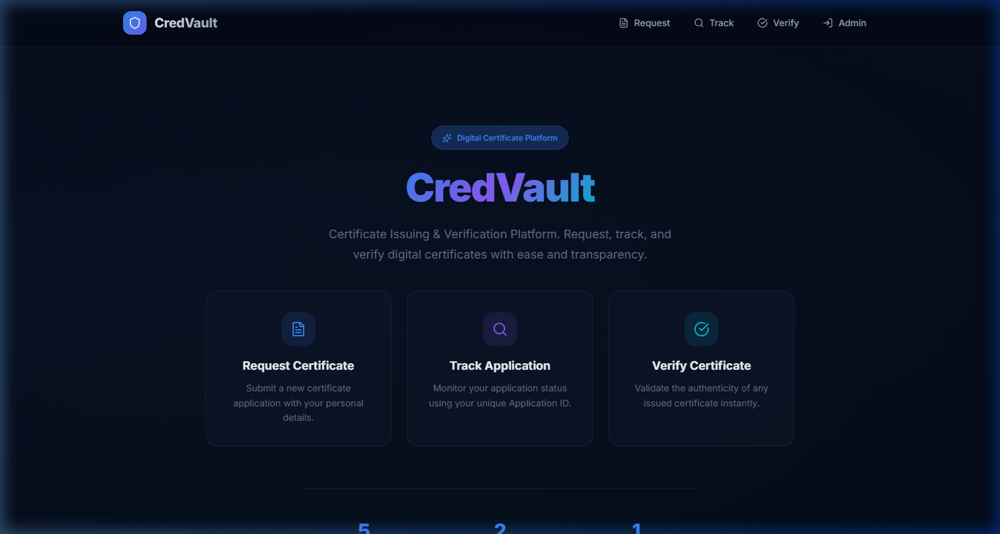
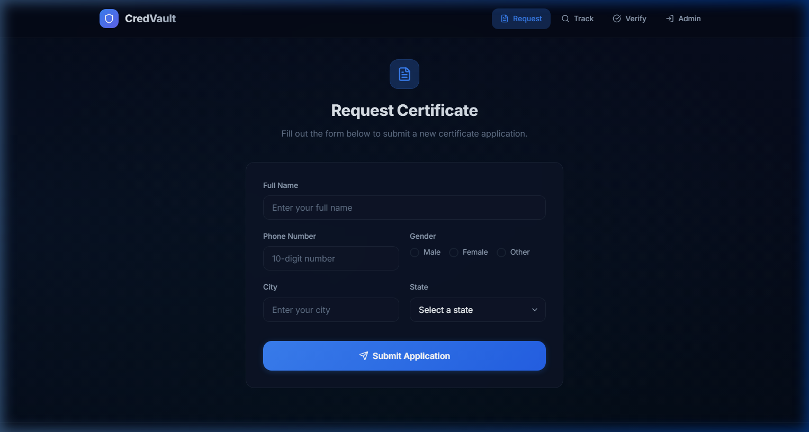
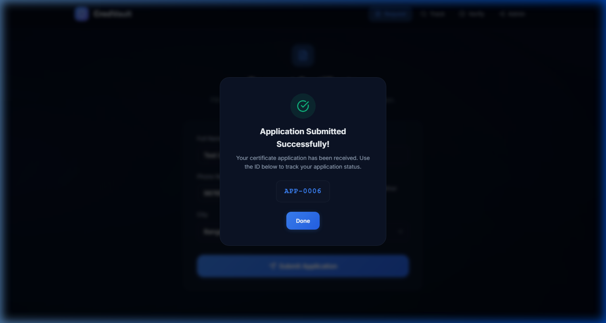
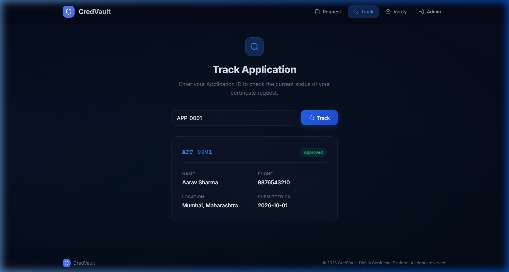
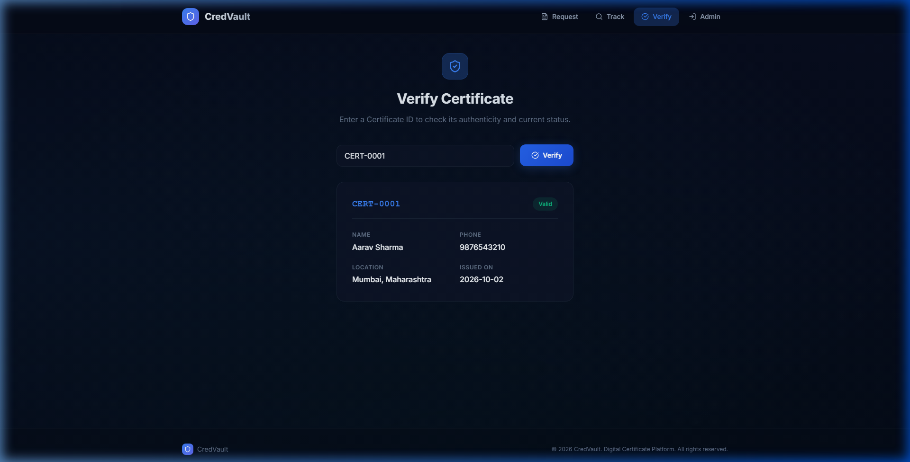
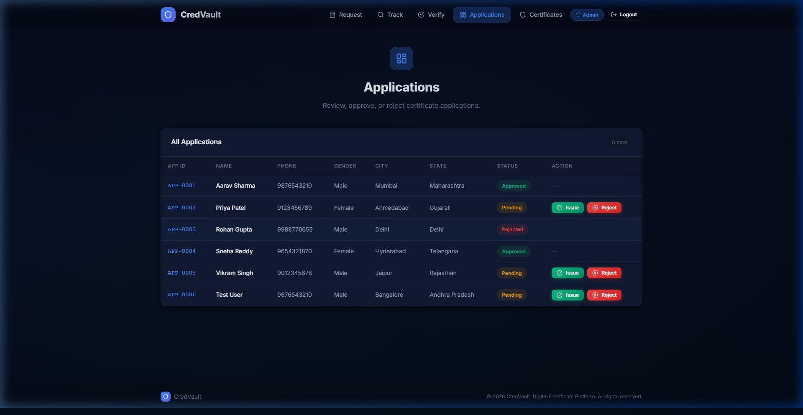
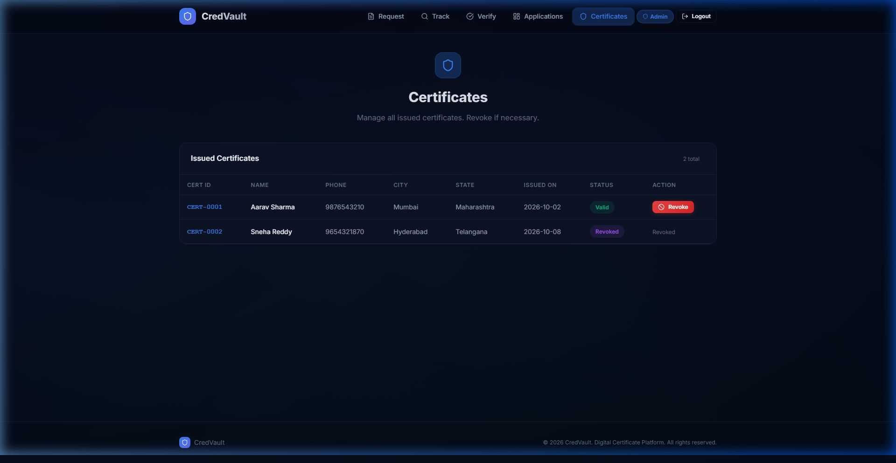

# CredVault — Digital Certificate Issuing & Verification Platform

A modern, frontend-only digital certificate platform where citizens can request certificates, track applications, and verify certificates. Admins can manage applications and certificates through a dedicated dashboard.

## 🚀 Features

- **Request Certificate** — Submit certificate applications with form validation
- **Track Application** — Look up application status by Application ID
- **Verify Certificate** — Validate certificate authenticity by Certificate ID
- **Admin Dashboard** — Manage applications (Issue/Reject) and certificates (Revoke)
- **Responsive Design** — Works on desktop, tablet, and mobile
- **Data Persistence** — LocalStorage-backed state survives page refreshes

## 🛠️ Tech Stack

| Technology | Purpose |
|------------|---------|
| React 18 | UI framework |
| Vite | Build tool & dev server |
| React Router v6 | Client-side routing |
| Lucide React | Icon library |
| Vanilla CSS | Styling with custom properties |

## 📁 Project Structure

```
src/
├── main.jsx                       # Entry point
├── App.jsx                        # Router & layout
├── index.css                      # Design system & global styles
├── context/
│   └── AppContext.jsx             # Global state + dummy data
├── components/
│   ├── Navbar.jsx / .css          # Navigation bar
│   ├── Footer.jsx / .css          # Page footer
│   └── PageWrapper.jsx / .css     # Reusable page layout
└── pages/
    ├── HomePage.jsx / .css              # Landing page
    ├── RequestPage.jsx / .css           # Certificate request form
    ├── TrackPage.jsx / .css             # Application tracking
    ├── VerifyPage.jsx                   # Certificate verification
    ├── AdminLoginPage.jsx / .css        # Admin login
    ├── AdminApplicationsPage.jsx        # Manage applications
    ├── AdminCertificatesPage.jsx        # Manage certificates
    └── AdminPages.css                   # Shared admin styles
```

## 📦 Getting Started

```bash
# Install dependencies
npm install

# Start development server
npm run dev

# Build for production
npm run build
```

The app will be available at `http://localhost:5173/`

## 🔐 Admin Credentials

| Field | Value |
|-------|-------|
| Username | `admin` |
| Password | `admin` |

## 📸 Screenshots

### 1. Home Page (`/`)


### 2. Request Certificate (`/request`)


### 3. Success Modal (after submitting)


### 4. Track Application (`/track`)


### 5. Verify Certificate (`/verify`)


### 6. Admin Applications (`/admin/applications`)


### 7. Admin Certificates (`/admin/certificates`)


## 📋 Pages Overview

| # | Page | Route | Description |
|---|------|-------|-------------|
| 1 | Home | `/` | Landing page with CTA cards |
| 2 | Request Certificate | `/request` | Form to submit a new application |
| 3 | Track Application | `/track` | Search by Application ID |
| 4 | Verify Certificate | `/verify` | Search by Certificate ID |
| 5 | Admin Login | `/admin/login` | Admin authentication |
| 6 | Admin Applications | `/admin/applications` | Issue/Reject applications |
| 7 | Admin Certificates | `/admin/certificates` | Revoke certificates |

## 📝 Notes

- This is a **frontend-only** prototype — all data uses dummy seed data stored in localStorage
- No backend or database is required
- The project is designed for backend integration in the next task
