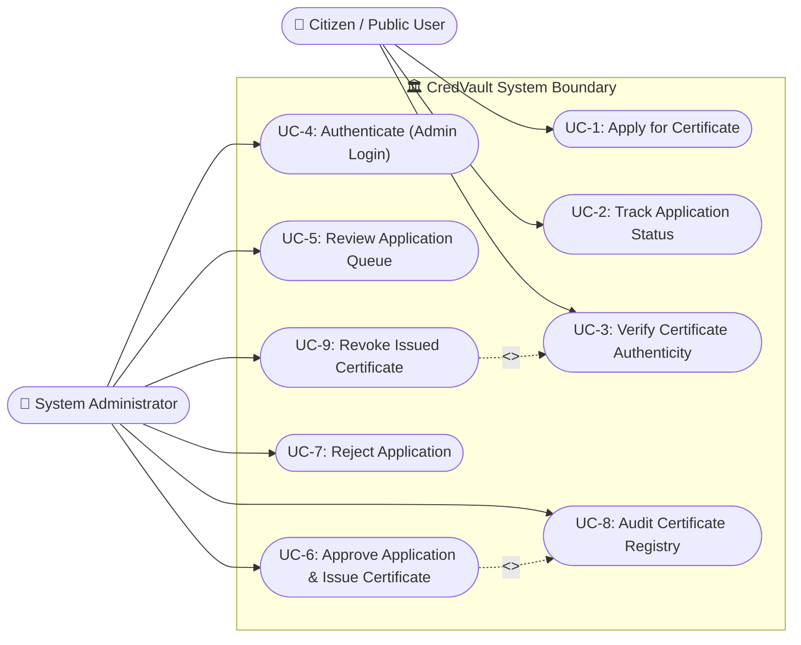
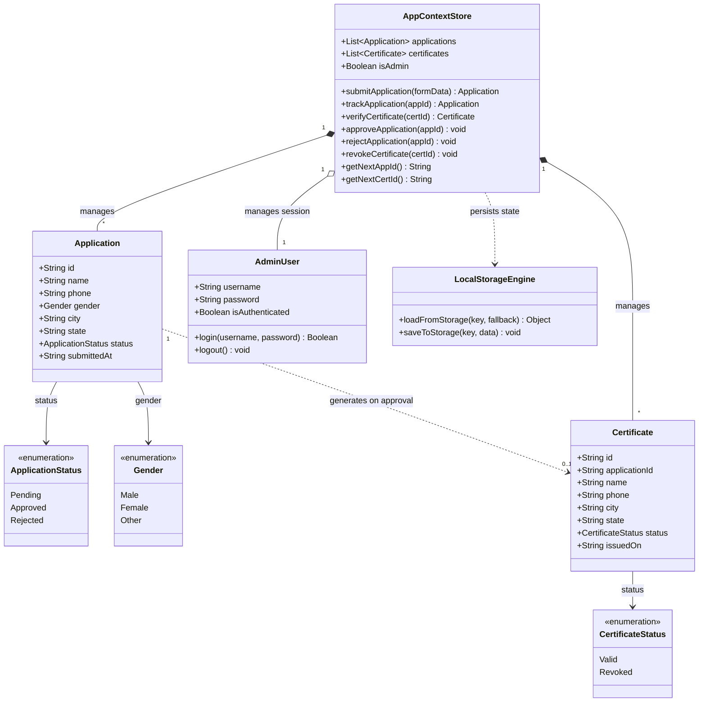
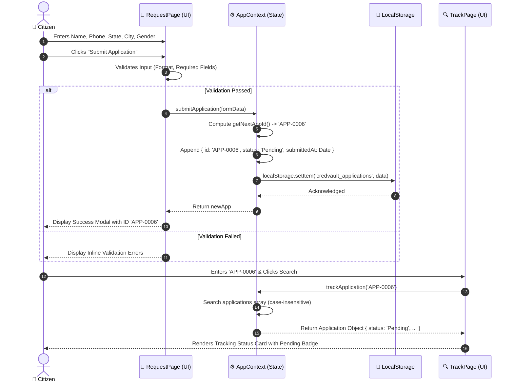
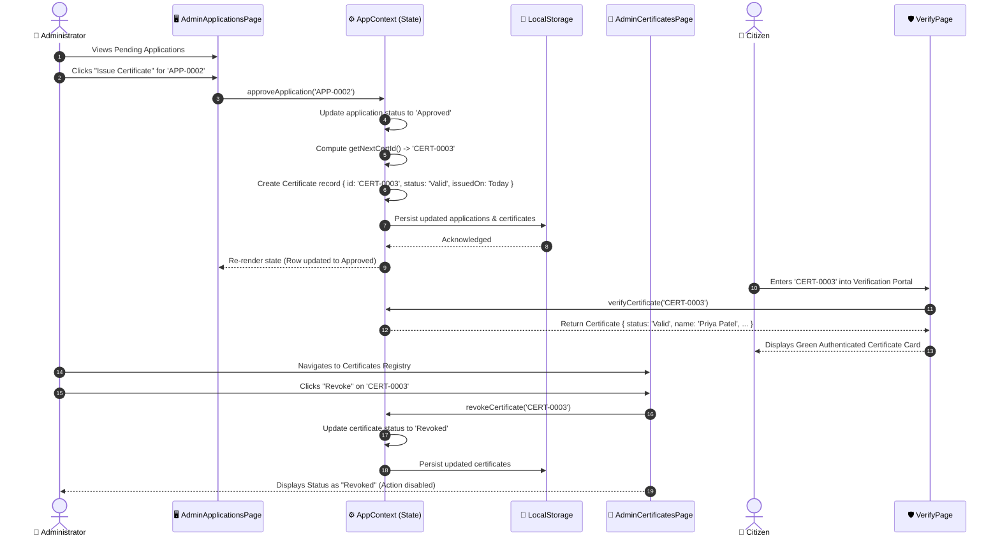
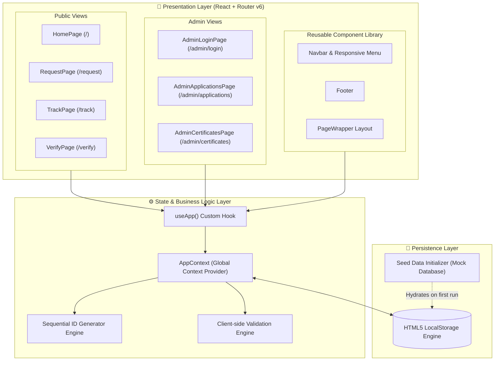

# CredVault — Digital Certificate Issuing & Verification Platform

[](https://react.dev/)
[](https://vitejs.dev/)
[](https://reactrouter.com/)
[](LICENSE)
[]()

> **CredVault** is a digital certificate management and verification platform. It enables citizens to seamlessly submit certificate applications, track their status in real-time, and verify existing digital credentials. Authorized administrators can review submissions, approve applications (auto-issuing digital certificates), reject invalid entries, and revoke certificates.

---

## 📑 Table of Contents

1. [Project Overview](#-project-overview)
2. [Key Features](#-key-features)
3. [UML Diagrams & System Design](#-uml-diagrams--system-design)
   - [1. UML Use Case Diagram](#1-uml-use-case-diagram)
   - [2. UML Class & Domain Model Diagram](#2-uml-class--domain-model-diagram)
   - [3. UML Sequence Diagram: Citizen Request & Tracking Flow](#3-uml-sequence-diagram-citizen-request--tracking-flow)
   - [4. UML Sequence Diagram: Admin Issuance Flow](#4-uml-sequence-diagram-admin-issuance-flow)
   - [5. UML State Machine Diagram: Lifecycle States](#5-uml-state-machine-diagram-lifecycle-states)
   - [6. UML Component & Architecture Diagram](#6-uml-component--architecture-diagram)
4. [Tech Stack](#-tech-stack)
5. [Project Structure](#-project-structure)
6. [Screenshots & Visual Tour](#-screenshots--visual-tour)
7. [Getting Started & Local Setup](#-getting-started--local-setup)
8. [Admin Access & Demo Test Data](#-admin-access--demo-test-data)
9. [Data Storage & Persistence](#-data-storage--persistence)
10. [Roadmap & Future Extensions](#-roadmap--future-extensions)

---

## 🌟 Project Overview

Traditional public credential issuance often suffers from bureaucratic delays, lack of transparency, and vulnerability to document tampering. **CredVault** solves these challenges by providing:

- **Self-Service Citizen Portal:** Instant application dispatch with validation and unique identifier tracking (`APP-XXXX`).
- **Cryptographic/Id-Based Verification:** Publicly accessible lookup engine verifying certificate validity (`CERT-XXXX`) in milliseconds.
- **Admin Command Center:** Audit trail interface allowing authorized staff to inspect, approve, reject, or revoke credentials.
- **Zero-Latency Client-Side Persistence:** Complete frontend state persistence through HTML5 LocalStorage, with zero backend dependency for rapid prototyping and validation.

---

## ⚡ Key Features

| Category | Capability | Description |
|---|---|---|
| **Public Services** | 📝 **Certificate Application** | Full form validation (Name, 10-digit Phone, State, City, Gender) with immediate receipt generation. |
| | 🔍 **Live Application Tracking** | Real-time status lookup (`Pending`, `Approved`, `Rejected`) using unique Application ID. |
| | 🛡️ **Instant Verification** | Public credential authenticity check returning status (`Valid`, `Revoked`), holder details, and issuance date. |
| **Admin Controls** | 🔐 **Secure Officer Login** | Protected routes for authenticated administrative staff. |
| | 📂 **Application Queue Management** | Filterable table of all citizen applications with one-click **Issue** or **Reject** workflows. |
| | 📜 **Certificate Registry & Revocation** | Centralized ledger of issued certificates with real-time **Revoke** capability. |
| **Design System** | 🎨 **Premium Modern UI** | Dark glassmorphism theme, vibrant gradients, micro-animations, fully responsive on mobile, tablet, and desktop. |

---

## 📐 UML Diagrams & System Design

To provide a comprehensive technical understanding of CredVault's architecture and interactions, the following **Unified Modeling Language (UML)** specifications illustrate the system across multiple perspectives.

---

### 1. UML Use Case Diagram

The Use Case diagram illustrates the system boundaries, the primary actors (**Citizen** and **Administrator**), and their interactions with CredVault's core capabilities.



---

### 2. UML Class & Domain Model Diagram

The Class Diagram highlights the structural data models, entity relationships, enumerations, and service interfaces implemented in CredVault.



---

### 3. UML Sequence Diagram: Citizen Request & Tracking Flow

This sequence diagram depicts the end-to-end user interaction when a citizen fills out an application form, submits it, receives an Application ID, and subsequently tracks its status.



---

### 4. UML Sequence Diagram: Admin Issuance Flow

This sequence diagram depicts the workflow where an Administrator reviews the submitted application, approves it, automatically issues a verifiable certificate, and revokes it if necessary.



---

### 5. UML State Machine Diagram: Lifecycle States

The State Machine diagram models the finite state transitions for both **Application** submissions and **Certificate** issuances.

```mermaid
stateDiagram-v2
    direction TB

    %% Application Lifecycle
    state "Application Lifecycle" as AppLifecycle {
        [*] --> Draft : User fills form
        Draft --> Pending : Form submitted
        
        state Pending {
            description: "Awaiting administrative review"
        }

        Pending --> Approved : Admin Approves / Issues
        Pending --> Rejected : Admin Rejects (Invalid data)

        state Approved {
            description: "Approved & Certificate generated"
        }

        state Rejected {
            description: "Terminal rejection state"
        }

        Approved --> [*]
        Rejected --> [*]
    }

    %% Certificate Lifecycle
    state "Certificate Lifecycle" as CertLifecycle {
        [*] --> Valid : Triggered by Application Approval
        
        state Valid {
            description: "Active, authentic, and verifiable"
        }

        Valid --> Revoked : Officer Revokes Certificate

        state Revoked {
            description: "Invalidated, flagged in verification checks"
        }

        Revoked --> [*]
    }
```

---

### 6. UML Component & Architecture Diagram

This component diagram highlights the multi-tier frontend software architecture, modular directory segregation, and data-flow pipelines.



---

## 🛠️ Tech Stack

| Technology | Role | Highlights & Rationale |
|---|---|---|
| **React 18** | UI Framework | Component-based architecture, hooks (`useState`, `useEffect`, `useContext`) |
| **Vite 5** | Bundler & Dev Server | Sub-second HMR, optimized production build bundle |
| **React Router v6** | Client-Side Routing | Declarative routing, browser history management, clean URL paths |
| **Lucide React** | Icons | Crisp, lightweight SVG vector icons matching design themes |
| **Vanilla CSS3** | Styling & Theme | Custom CSS variables, responsive grid & flexbox, glassmorphic backdrop filters |
| **HTML5 LocalStorage** | Data Persistence | Zero-configuration offline persistence across browser reloads |

---

## 📁 Project Structure

```
CredVault/
├── screenshots/                       # High-resolution application screenshots
│   ├── 01-homepage.png
│   ├── 02-request-form.png
│   ├── 03-success-modal.png
│   ├── 04-track-application.png
│   ├── 05-verify-certificate.png
│   ├── 06-admin-applications.png
│   └── 07-admin-certificates.png
├── src/
│   ├── main.jsx                       # Application entrypoint & DOM mounting
│   ├── App.jsx                        # Route table configuration & Root provider
│   ├── index.css                      # Design tokens, typography & global CSS
│   ├── context/
│   │   └── AppContext.jsx             # State provider, localStorage adapter & mock database
│   ├── components/
│   │   ├── Navbar.jsx & Navbar.css    # Responsive top navigation & mobile drawer
│   │   ├── Footer.jsx & Footer.css    # Standard footer with navigation links
│   │   └── PageWrapper.jsx & .css     # Standardized container layout
│   └── pages/
│       ├── HomePage.jsx & .css        # Landing hero, CTA cards & live statistics
│       ├── RequestPage.jsx & .css     # Certificate submission form with modal
│       ├── TrackPage.jsx & .css       # Search & application tracking cards
│       ├── VerifyPage.jsx             # Public certificate authenticity engine
│       ├── AdminLoginPage.jsx & .css  # Authenticated officer login screen
│       ├── AdminApplicationsPage.jsx  # Application review queue & issuance
│       ├── AdminCertificatesPage.jsx  # Certificate registry & revocation ledger
│       └── AdminPages.css             # Shared styles for administrative portals
├── index.html                         # HTML template with Google Fonts (Outfit)
├── package.json                       # Dependencies & build scripts
└── vite.config.js                     # Vite build configuration
```

---

## 📸 Screenshots & Visual Tour

### 1. Home Page (`/`)
*Interactive hero section with quick-action cards, platform metrics, and workflow guide.*


---

### 2. Request Certificate (`/request`)
*Citizen application form with validation on contact numbers, state selection, and personal details.*


---

### 3. Application Submission Success Modal
*Instant confirmation dialog providing the generated `APP-XXXX` ID and a one-click tracking redirect.*


---

### 4. Track Application (`/track`)
*Real-time status inspector displaying submission details, date, and visual status indicators.*


---

### 5. Verify Certificate (`/verify`)
*Public authenticity check displaying security badge, issue date, recipient information, and validity status.*


---

### 6. Admin Applications Management (`/admin/applications`)
*Administrative dashboard allowing officers to inspect incoming applications and Issue or Reject them.*


---

### 7. Admin Certificate Registry (`/admin/certificates`)
*Central certificate ledger displaying all active credentials with real-time revocation controls.*


---

## 🚀 Getting Started & Local Setup

### Prerequisites
- Node.js (v18.0.0 or higher recommended)
- npm (v9.0.0 or higher)

### Installation Steps

1. **Clone the repository:**
   ```bash
   git clone https://github.com/siddharth03015/CredVault-Elevate-Skills-Project.git
   cd CredVault-Elevate-Skills-Project
   ```

2. **Install project dependencies:**
   ```bash
   npm install
   ```

3. **Start the local development server:**
   ```bash
   npm run dev
   ```

4. **Open in browser:**
   Navigate to `http://localhost:5173/` in your preferred browser.

5. **Build for production:**
   ```bash
   npm run build
   npm run preview
   ```

---

## 🔐 Admin Access & Demo Test Data

### Administrative Credentials
To access `/admin/applications` and `/admin/certificates`, navigate to `/admin/login` and use:

| Field | Credentials |
|---|---|
| **Username** | `admin` |
| **Password** | `admin` |

---

### Pre-loaded Sample Test Records

You can test the search and lookup tools right away using these pre-seeded identifiers:

#### Application Tracking IDs (`/track`)
| Application ID | Applicant Name | Initial Status |
|---|---|---|
| `APP-0001` | Aarav Sharma | **Approved** |
| `APP-0002` | Priya Patel | **Pending** *(Try issuing this in Admin!)* |
| `APP-0003` | Rohan Gupta | **Rejected** |
| `APP-0004` | Sneha Reddy | **Approved** |
| `APP-0005` | Vikram Singh | **Pending** |

#### Certificate Verification IDs (`/verify`)
| Certificate ID | Certificate Holder | Initial Status |
|---|---|---|
| `CERT-0001` | Aarav Sharma | 🟢 **Valid** |
| `CERT-0002` | Sneha Reddy | 🔴 **Revoked** |

---

## 💾 Data Storage & Persistence

CredVault uses a client-side database simulation backed by HTML5 `localStorage`:

- `credvault_applications`: Stores an array of all submitted citizen applications.
- `credvault_certificates`: Stores all issued and revoked certificate records.
- `credvault_admin`: Preserves officer authentication session across reloads.

> **Resetting Data:** To restore the application to initial factory state, open your browser's Developer Tools Console (`F12`), run `localStorage.clear()`, and refresh the page.

---

## 🗺️ Roadmap & Future Extensions

- [ ] **Backend Integration:** Connect with Node.js/Express or FastAPI REST endpoints.
- [ ] **PDF Certificate Export:** Generate cryptographically signed, downloadable PDF certificates.
- [ ] **QR Code Verification:** Scan dynamic QR codes on certificates for zero-click instant verification.
- [ ] **Decentralized Verification:** Anchor certificate hashes to an immutable ledger (Ethereum / Polygon).
- [ ] **SMS & Email Alerts:** Automated notifications upon status changes (`Approved` / `Rejected`).

---

## 📄 License

This project is licensed under the [MIT License](LICENSE).
