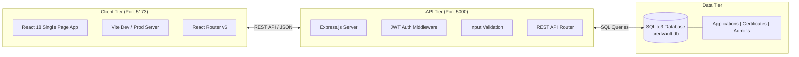
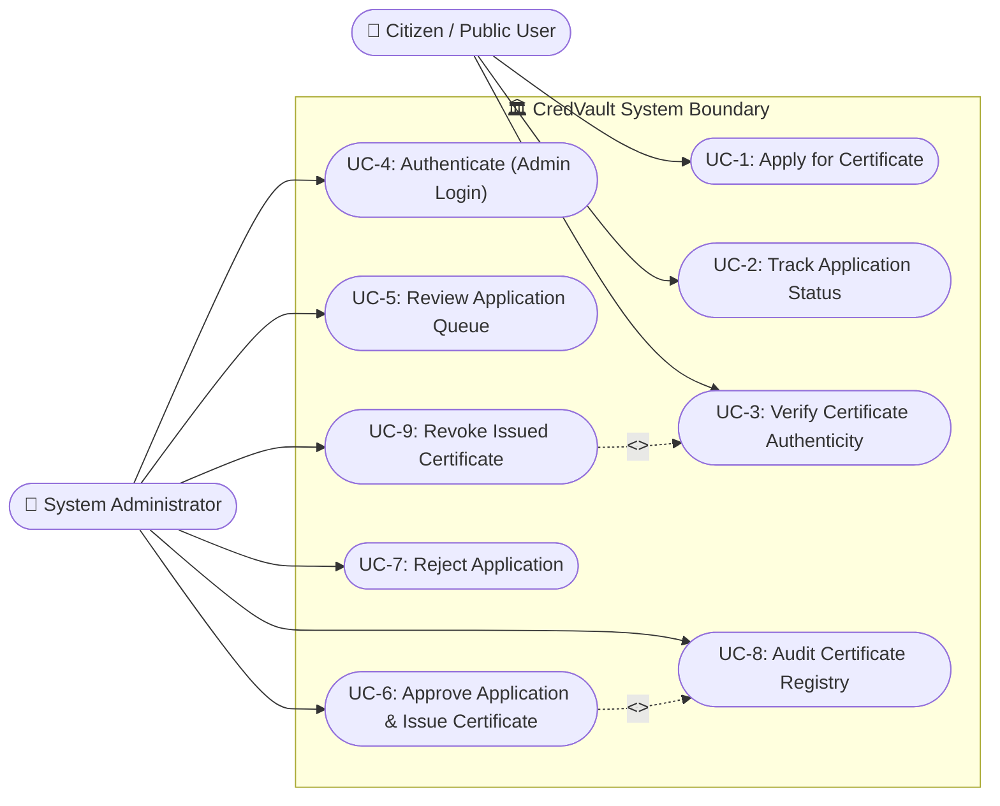
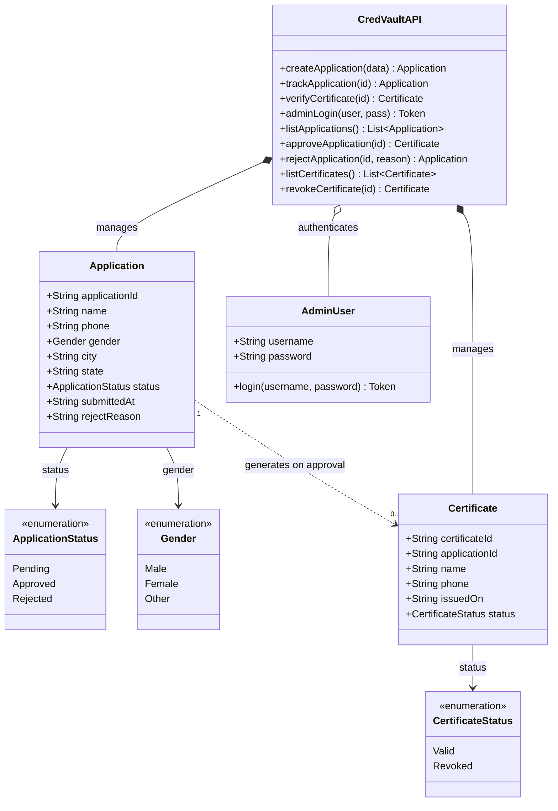
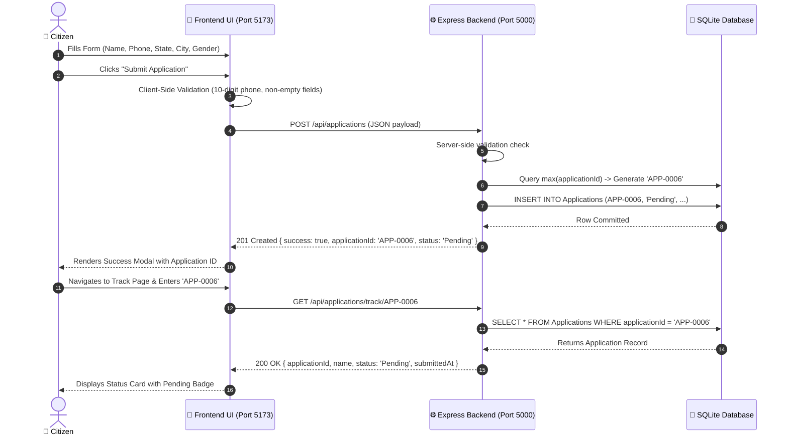
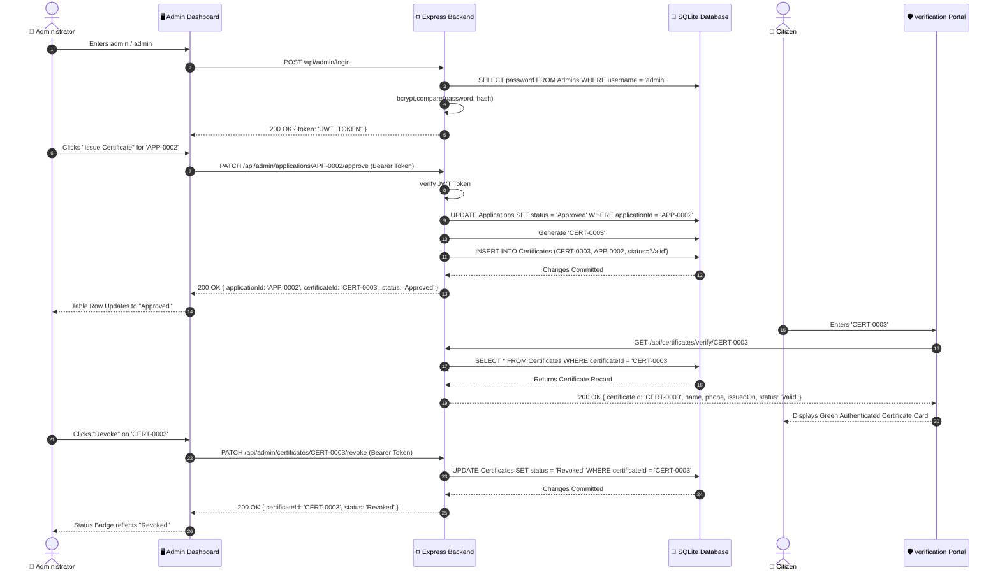
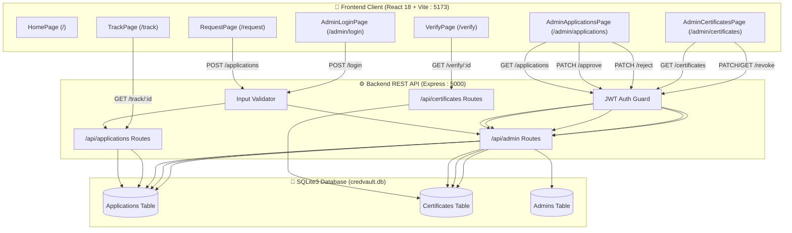

# CredVault — Digital Certificate Issuing & Verification Platform

[](https://react.dev/)
[](https://vitejs.dev/)
[](https://nodejs.org/)
[](https://expressjs.com/)
[](https://sqlite.org/)
[](https://jwt.io/)
[](LICENSE)
[]()

> **CredVault** is a full-stack digital certificate management and verification platform. It allows citizens to seamlessly apply for certificates, track applications in real-time, and verify credential authenticity. Administrators can review queues, approve applications (auto-issuing verifiable credentials), reject submissions, and revoke certificates.
> 
> The platform includes both a **React 18 + Vite frontend** and a **Node.js + Express + SQLite3 backend REST API engine** with automated test suites.

---

## 📑 Table of Contents

1. [Project Overview](#-project-overview)
2. [Architecture & System Design](#-architecture--system-design)
3. [Key Features](#-key-features)
4. [UML Diagrams & System Specifications](#-uml-diagrams--system-specifications)
   - [1. UML Use Case Diagram](#1-uml-use-case-diagram)
   - [2. UML Class & Domain Model Diagram](#2-uml-class--domain-model-diagram)
   - [3. UML Sequence Diagram: Citizen Flow](#3-uml-sequence-diagram-citizen-flow)
   - [4. UML Sequence Diagram: Admin Issuance Flow](#4-uml-sequence-diagram-admin-issuance-flow)
   - [5. UML State Machine Diagram](#5-uml-state-machine-diagram)
   - [6. UML Full-Stack Component & Data Flow Diagram](#6-uml-full-stack-component--data-flow-diagram)
5. [Backend REST API Specifications](#-backend-rest-api-specifications)
6. [Database Models & Schemas](#-database-models--schemas)
7. [Screenshots & Visual Tour](#-screenshots--visual-tour)
8. [Full-Stack Tech Stack](#-full-stack-tech-stack)
9. [Project Structure](#-project-structure)
10. [Local Setup & Running Instructions](#-local-setup--running-instructions)
11. [Automated API Testing](#-automated-api-testing)
12. [Admin Credentials & Seed Test Records](#-admin-credentials--seed-test-records)
13. [License](#-license)

---

## 🌟 Project Overview

Traditional public document issuance is vulnerable to manual delays, record tampering, and forged physical certificates. **CredVault** delivers a robust digital alternative:

- **Self-Service Citizen Portal:** Public form validation, instant confirmation receipts, and unique tracking IDs (`APP-XXXX`).
- **Real-Time Tracking & Verification:** Sub-millisecond lookup for tracking status and verifying certificate validity (`CERT-XXXX`).
- **Admin Command Center:** Officer audit dashboard with one-click **Approve & Issue**, **Reject**, and **Revoke** controls.
- **Relational Backend Engine:** Express REST APIs backed by SQLite3 (`credvault.db`) with foreign key constraints, automated sequential ID generation, and JWT authentication.

---

## 🏗️ Architecture & System Design



---

## ⚡ Key Features

| Category | Capability | Description |
|---|---|---|
| **Public Services** | 📝 **Certificate Request** | Citizen application form with full validation (Name, 10-digit Phone, State, City, Gender) and immediate receipt modal. |
| | 🔍 **Application Tracking** | Look up application lifecycle status (`Pending`, `Approved`, `Rejected`) by Application ID (`APP-XXXX`). |
| | 🛡️ **Instant Verification** | Public authenticity verification check returning status (`Valid`, `Revoked`), holder details, and issue date. |
| **Admin Operations** | 🔐 **JWT Authentication** | Salted bcrypt passwords and JWT bearer tokens protecting sensitive officer endpoints. |
| | 📂 **Application Management** | Real-time queue review with one-click **Issue** (auto-generates certificate) and **Reject** workflows. |
| | 📜 **Certificate Registry** | Comprehensive credentials ledger with immediate **Revocation** capability. |
| **Data Integrity** | 🔒 **Strict Lifecycle Rules** | When a certificate is revoked, only the certificate status changes to `Revoked`; original application remains intact. |
| | 🧪 **Automated Test Suite** | 34 automated unit/integration tests covering all 9 API endpoints, auth guards, and status transitions. |

---

## 📐 UML Diagrams & System Specifications

---

### 1. UML Use Case Diagram



---

### 2. UML Class & Domain Model Diagram



---

### 3. UML Sequence Diagram: Citizen Flow



---

### 4. UML Sequence Diagram: Admin Issuance Flow



---

### 5. UML State Machine Diagram

```mermaid
stateDiagram-v2
    direction TB

    state "Application Lifecycle" as AppLifecycle {
        [*] --> Draft : User fills form
        Draft --> Pending : Form submitted (POST /api/applications)
        
        state Pending {
            description: "Awaiting administrative review"
        }

        Pending --> Approved : Officer Approves (PATCH /approve)
        Pending --> Rejected : Officer Rejects (PATCH /reject)

        state Approved {
            description: "Auto-creates Certificate with Valid status"
        }

        state Rejected {
            description: "Terminal rejection with reason"
        }

        Approved --> [*]
        Rejected --> [*]
    }

    state "Certificate Lifecycle" as CertLifecycle {
        [*] --> Valid : Generated upon Application Approval
        
        state Valid {
            description: "Authentic & Verifiable"
        }

        Valid --> Revoked : Officer Revokes (PATCH/GET /revoke)

        state Revoked {
            description: "Flagged Invalid during public verification"
        }

        Revoked --> [*]
    }
```

---

### 6. UML Full-Stack Component & Data Flow Diagram



---

## 🌐 Backend REST API Specifications

The backend server exposes **9 RESTful endpoints** matching the ELEVATE specification:

| # | Endpoint | Method | Auth | Body / Params | Response |
|---|---|---|---|---|---|
| **1** | `/api/applications` | `POST` | Public | `{ name, phone, gender, city, state }` | `201 Created`: `{ success, applicationId, status: "Pending" }` |
| **2** | `/api/applications/track/:applicationId` | `GET` | Public | Param: `applicationId` | `200 OK`: `{ applicationId, name, status, submittedAt }` or `404` |
| **3** | `/api/certificates/verify/:certificateId` | `GET` | Public | Param: `certificateId` | `200 OK`: `{ certificateId, name, phone, issuedOn, status }` or `404` |
| **4** | `/api/admin/login` | `POST` | Public | `{ username, password }` | `200 OK`: `{ token, admin: { username } }` or `401` |
| **5** | `/api/admin/applications` | `GET` | Bearer Token | None | `200 OK`: `{ count, applications: [...] }` |
| **6** | `/api/admin/applications/:applicationId/approve` | `PATCH` | Bearer Token | Param: `applicationId` | `200 OK`: Sets `Approved`, creates `CERT-XXXX` with `Valid` |
| **7** | `/api/admin/applications/:applicationId/reject` | `PATCH` | Bearer Token | Param: `applicationId`, optional `{ reason }` | `200 OK`: Sets `Rejected` with reason |
| **8** | `/api/admin/certificates` | `GET` | Bearer Token | None | `200 OK`: `{ count, certificates: [...] }` |
| **9** | `/api/admin/certificates/:certificateId/revoke` | `PATCH` / `GET` | Bearer Token | Param: `certificateId` | `200 OK`: Sets `Revoked` *(Original app record unchanged)* |

---

## 🗄️ Database Models & Schemas

The backend uses embedded SQLite (`credvault.db`) with foreign key constraints:

### 1. `Applications` Table
```sql
CREATE TABLE Applications (
  applicationId TEXT PRIMARY KEY,
  name TEXT NOT NULL,
  phone TEXT NOT NULL,
  gender TEXT NOT NULL,
  city TEXT NOT NULL,
  state TEXT NOT NULL,
  status TEXT NOT NULL DEFAULT 'Pending' CHECK(status IN ('Pending', 'Approved', 'Rejected')),
  submittedAt TEXT NOT NULL,
  rejectReason TEXT DEFAULT NULL
);
```

### 2. `Certificates` Table
```sql
CREATE TABLE Certificates (
  certificateId TEXT PRIMARY KEY,
  applicationId TEXT NOT NULL,
  name TEXT NOT NULL,
  phone TEXT NOT NULL,
  issuedOn TEXT NOT NULL,
  status TEXT NOT NULL DEFAULT 'Valid' CHECK(status IN ('Valid', 'Revoked')),
  FOREIGN KEY (applicationId) REFERENCES Applications(applicationId)
);
```

### 3. `Admins` Table
```sql
CREATE TABLE Admins (
  username TEXT PRIMARY KEY,
  password TEXT NOT NULL
);
```

---

## 📸 Screenshots & Visual Tour

### 1. Home Page (`/`)


### 2. Request Certificate (`/request`)


### 3. Application Submission Success Modal


### 4. Track Application (`/track`)


### 5. Verify Certificate (`/verify`)


### 6. Admin Applications Management (`/admin/applications`)


### 7. Admin Certificate Registry (`/admin/certificates`)


---

## 🛠️ Full-Stack Tech Stack

| Layer | Technology | Version | Purpose |
|---|---|---|---|
| **Frontend Framework** | **React** | `18.x` | Declarative component UI |
| **Build & Dev Server** | **Vite** | `5.x` | Instant HMR and asset bundling |
| **Routing** | **React Router** | `v6` | Client-side routing and layout rendering |
| **Icons** | **Lucide React** | `1.55+` | Clean SVG iconography |
| **Backend Runtime** | **Node.js** | `20+` | Asynchronous JavaScript runtime |
| **API Framework** | **Express.js** | `4.21+` | RESTful routing and middleware engine |
| **Database** | **SQLite3** | `5.1+` | Zero-config embedded relational database |
| **Authentication** | **JWT & bcryptjs** | `9.0 / 2.4` | Bearer token authorization and salted hashing |
| **Styling** | **Vanilla CSS3** | Modern | Glassmorphism, CSS variables, and responsive layout |

---

## 📁 Project Structure

```
CredVault/
├── backend/                           # ⚙️ Dedicated Backend Project (Task 3)
│   ├── .env                           # Environment configuration (Port 5000, JWT Secret)
│   ├── .env.example                   # Configuration template
│   ├── .gitignore                     # Git ignore rules (node_modules, db files)
│   ├── package.json                   # Dependencies & npm scripts
│   ├── README.md                      # Backend specific API reference
│   ├── test-api.js                    # 34-assertion automated test suite
│   ├── credvault.db                   # SQLite database file
│   └── src/
│       ├── server.js                  # Express app, middleware & route mounting
│       ├── db.js                      # Database adapter, schemas & sequential ID generators
│       ├── middleware/
│       │   ├── auth.js                # JWT & Bearer token guard
│       │   └── validation.js          # Request payload validators
│       └── routes/
│           ├── applicationRoutes.js   # Citizen application routes
│           ├── certificateRoutes.js   # Certificate verification routes
│           └── adminRoutes.js         # Admin authorization & management routes
├── screenshots/                       # 📸 High-resolution UI screenshots (Task 2)
│   ├── 01-homepage.png
│   ├── 02-request-form.png
│   ├── 03-success-modal.png
│   ├── 04-track-application.png
│   ├── 05-verify-certificate.png
│   ├── 06-admin-applications.png
│   └── 07-admin-certificates.png
├── src/                               # 🎨 React Frontend Client (Task 2)
│   ├── main.jsx                       # Entrypoint
│   ├── App.jsx                        # Route configuration
│   ├── index.css                      # Global styles & design system
│   ├── context/AppContext.jsx         # Global state & LocalStorage engine
│   ├── components/                    # Navbar, Footer, PageWrapper
│   └── pages/                         # All 7 frontend application views
├── package.json                       # Frontend dependencies & scripts
├── vite.config.js                     # Vite build configuration
└── README.md                          # Full-stack documentation
```

---

## 🚀 Local Setup & Running Instructions

### 1. Prerequisites
- **Node.js**: v18.0.0 or higher
- **npm**: v9.0.0 or higher

### 2. Running the Frontend Portal (Port 5173)
```powershell
# Open terminal in root directory
cd "e:\Elevate Skills"

# Install dependencies (first time only)
npm install

# Start Vite dev server
npm run dev
```
Open **[http://localhost:5173/](http://localhost:5173/)** in your browser.

### 3. Running the Backend API Server (Port 5000)
```powershell
# Open terminal in backend directory
cd "e:\Elevate Skills\backend"

# Install dependencies (first time only)
npm install

# Start the Express API server
npm start
```
The server will initialize the SQLite database (`credvault.db`), seed sample records, and start on **[http://localhost:5000](http://localhost:5000)**.
Health check: **[http://localhost:5000/api/health](http://localhost:5000/api/health)**

---

## 🧪 Automated API Testing

Run the automated integration test suite from the backend directory:

```powershell
cd "e:\Elevate Skills\backend"
npm test
```

### Test Suite Results:
```text
========================================
Test Results: 34 Passed, 0 Failed
========================================
```
The test suite covers:
- System health checks
- Valid and invalid application submissions
- Application tracking by ID & 404 handling
- Public certificate verification (Valid, Revoked, 404)
- Admin login (Valid JWT generation & 401 rejection)
- Protected route authentication guards
- Application approval and sequential certificate generation
- Application rejection with custom reason
- Certificate revocation and validation that original application record remains unchanged
- Both `PATCH` and `GET` revocation endpoint compatibility

---

## 🔐 Admin Credentials & Seed Test Records

### Administrator Credentials
- **Username:** `admin`
- **Password:** `admin`

### Seed Applications
| Application ID | Applicant Name | Initial Status |
|---|---|---|
| `APP-0001` | Aarav Sharma | **Approved** |
| `APP-0002` | Priya Patel | **Pending** |
| `APP-0003` | Rohan Gupta | **Rejected** |
| `APP-0004` | Sneha Reddy | **Approved** |
| `APP-0005` | Vikram Singh | **Pending** |

### Seed Certificates
| Certificate ID | Application ID | Recipient Name | Initial Status |
|---|---|---|---|
| `CERT-0001` | `APP-0001` | Aarav Sharma | 🟢 **Valid** |
| `CERT-0002` | `APP-0004` | Sneha Reddy | 🔴 **Revoked** |

---

## 📄 License

This project is licensed under the [MIT License](LICENSE).
